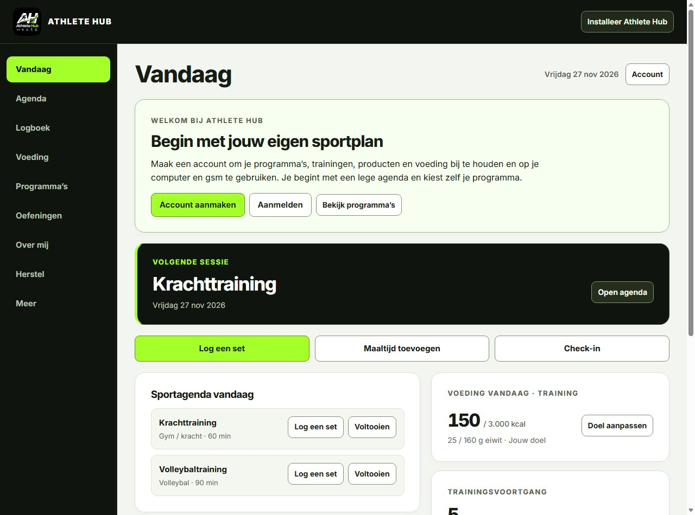

# Athlete Hub

Athlete Hub is een mobiele sportagenda en trainingslogboek voor sporters. Plan sessies, houd sets en persoonlijke records bij, en volg voeding, herstel en sprongtests. Het optionele tienwekenprogramma **Vertical Jump** is gericht op sprongkracht voor volleybal.

**[Open de live webapp](https://cdb5.github.io/athlete-hub/)**

## Gebruiken

- Open op je telefoon en kies **Installeer Athlete Hub** voor de stappen op jouw toestel.
- Zonder aanmelding verschijnt bij het openen een start-pop-up met **Account aanmaken** en **Aanmelden**, ook als er al lokale invoer is. Op Vandaag blijven de accountknoppen beschikbaar. Bij het rechtstreeks openen van `index.html` verwijzen deze knoppen naar de online versie; eerdere lokale invoer kun je met een JSON-back-up meenemen. Nieuwe bezoekers beginnen met een lege planning. Onder **Programma’s → Trainingsprogramma kiezen** voeg je zelf een programma toe. Een bestaande keuze en je logboek blijven aan jouw account gekoppeld.
- Het programma zet de nulmeting automatisch op de eerste maandag en de eindtest op woensdag in de taperweek. Op die dagen kun je het protocol via **Info** lezen en je resultaat invoeren.
- **Over mij** bevat je profiel, lengte, gewicht en sprongmetingen met hun geschiedenis. De voedingsstartdoelen onder **Voeding** kun je afstemmen op je herstel en gewichtstrend.
- Onder **Herstel** kun je **Polar Pacer Pro** kiezen en je waarden handmatig uit Polar Flow overnemen: onder andere slaap, Nightly Recharge, ochtend-rusthartslag en nachtelijke HRV. Hartslag en HRV krijgen een eigen referentie na minstens zeven eerdere metingen binnen 28 dagen. Het advies combineert deze trends met je eigen gevoel; de exacte afkapwaarden zijn coachingsregels. Bij de gymsessies van het Vertical Jump-programma kun je een lichtere variant kiezen en terugzetten. Er is geen automatische horlogekoppeling.
- Onder **Voeding → Mijn producten** bewaar je producten met hun merk, winkel, barcode en voedingswaarden per 100 g of ml. Houd een lijst bij van wat je koopt of wilt proberen en neem een product met een zelfgekozen portie over in je voedingslogboek. Barcodegegevens komen van [Open Food Facts](https://world.openfoodfacts.org/). Controleer ze met het etiket.
- De app slaat je gegevens lokaal op in IndexedDB. Via **Meer → Instellingen** kun je een JSON-back-up downloaden, terugzetten of je invoer wissen.
- **Meer → Account en synchronisatie** bevat aanmelden met gebruikersnaam/e-mail en wachtwoord, registratie, wachtwoordherstel en de synchronisatiestatus. Na het aansluiten van een eigen Supabase-project deelt hetzelfde account zijn gegevens tussen pc en gsm. De [SQL-bestanden en volledige installatiehandleiding](supabase/README.md) staan in de repository. Zonder aangesloten project blijft de lokale app bruikbaar.
- Ga je naar een ander toestel of een ander webadres? Exporteer eerst een back-up op het oude toestel of adres en importeer ze daarna op het nieuwe.
- Meld bugs of suggesties via [GitHub Issues](https://github.com/CDB5/athlete-hub/issues). Houd persoonlijke gegevens en back-ups privé.

## Publiceren

GitHub Pages serveert de hoofdmap van `main`. De app gebruikt relatieve bestandspaden zodat ze ook onder `/athlete-hub/` werkt. De service worker bewaart HTML, CSS, JavaScript en pictogrammen voor offline heropenen. Accountregistratie, aanmelden en online synchronisatie vereisen internet; bestaande accountgegevens en nog te verzenden wijzigingen hebben een lokale cache. Barcodezoekopdrachten en de eerste download van OCR-bestanden vereisen internet. Zet uitsluitend een publieke Supabase-URL en publishable key in `cloud-config.js`.
